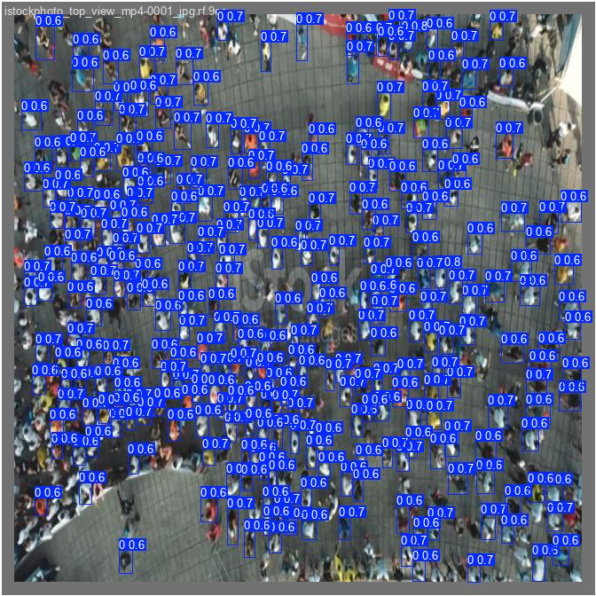
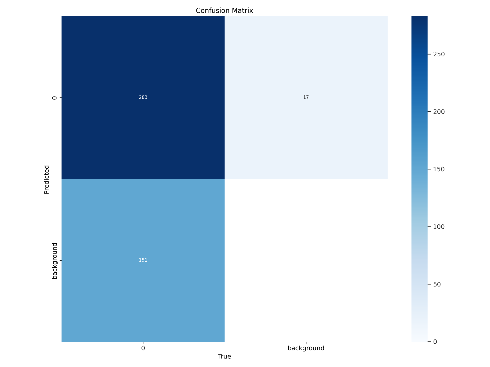
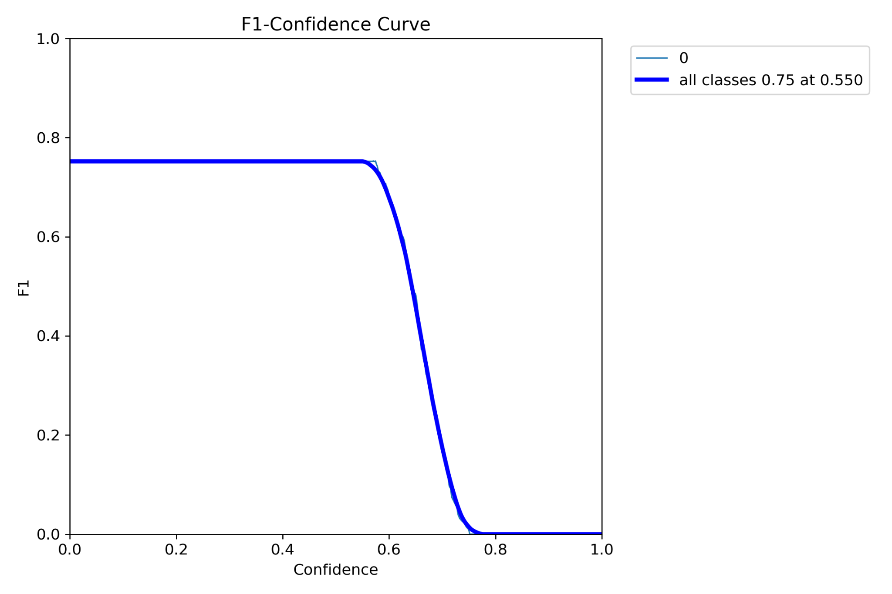
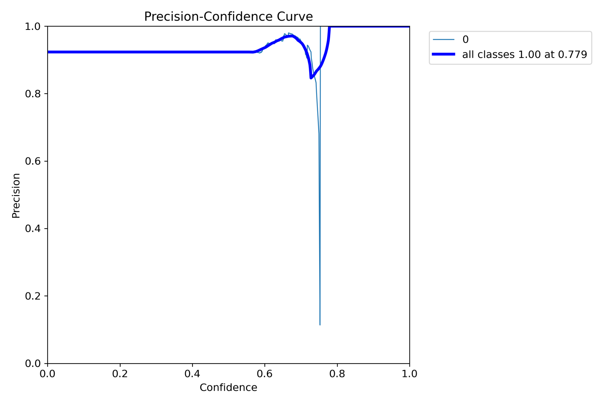
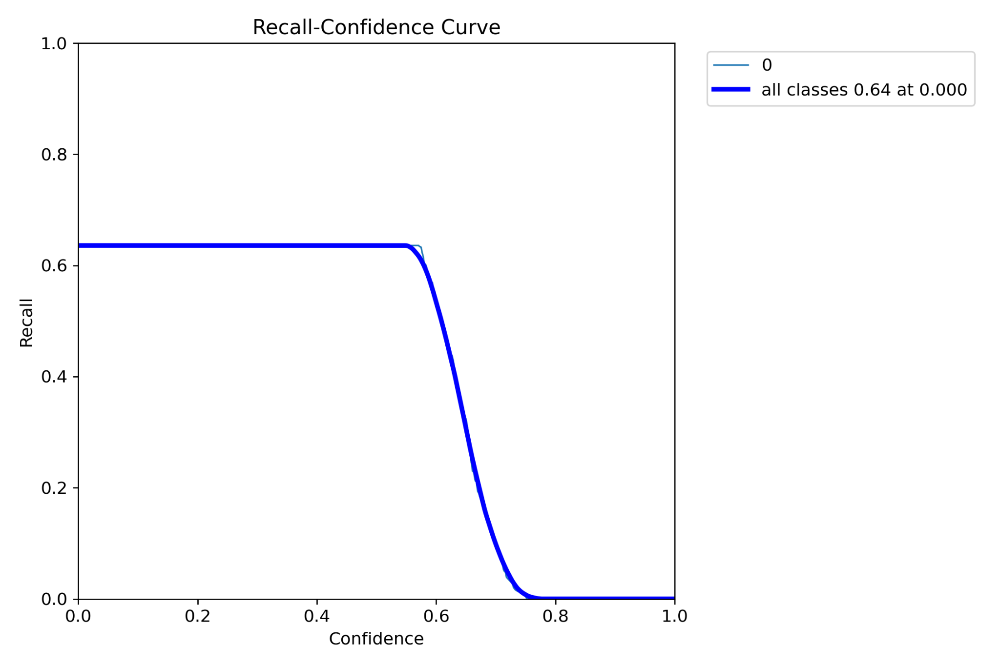

# Zahma — Model Results

## 1. Person Detection Results

The following image shows the YOLOv11s model detecting people using bounding boxes and confidence scores.

## 2. Confusion Matrix

## 3. Model Evaluation Curves

### F1-Confidence Curve

### Precision-Confidence Curve

### Recall-Confidence Curve

## Notes

These figures present experimental person-detection outputs and model evaluation results. Performance should be interpreted in the context of the dataset and evaluation settings.

Only share images and data that you have permission to publish.
